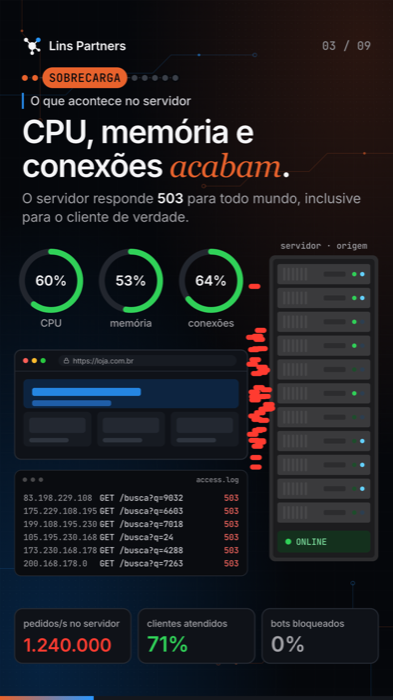
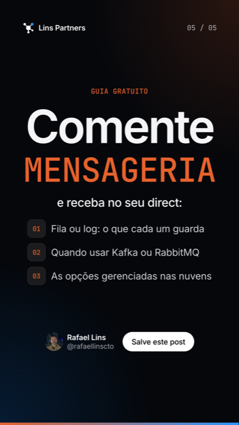

# Reels em código

Os reels animados que publico no Instagram e no LinkedIn são feitos em código, não em editor de vídeo. Cada cena é um componente React, e o [Remotion](https://www.remotion.dev) transforma esses componentes em MP4.

| Cena do reel sobre DDoS | Lâmina final do reel sobre mensageria |
|---|---|
|  |  |

## Por que em código

- **Tudo depende só do número do quadro.** Nenhuma animação usa relógio ou `requestAnimationFrame`: o quadro 300 sai igual na prévia e no render final, e dá para gerar qualquer instante como imagem para revisar.
- **Um molde, vários reels.** `ReelShell` cuida de marca, contador de cenas, trilha de etapas, resumo e lâmina final. Um reel novo é só a lista de cenas.
- **Tempo de leitura sem pausar a animação.** `tempoComPausa` estica cada cena em 2 segundos, e a animação continua rodando nesse tempo extra, em vez de congelar.
- **Revisão antes do vídeo.** Gero quadros soltos (`npm run still`) e confiro texto cortado, sobreposição e erro de português antes de renderizar o MP4.

## Como usar

```sh
npm ci
npm run studio                                            # prévia interativa no navegador
npm run still -- Ddos out/quadro.png --frame=300          # um quadro como imagem
npm run render -- Ddos out/ddos.mp4                       # vídeo completo, 1080 × 1920, 30 fps
```

Se o Chrome que o Remotion baixa não abrir no seu sistema, use o do computador: acrescente `--browser-executable="/caminho/do/Google Chrome"`.

O MP4 sai sem som. A música e os efeitos entram depois, com ffmpeg.

## Estrutura

| Arquivo | O que faz |
|---|---|
| `src/marca.tsx` | Nome, foto e arroba de quem publica. Troque aqui para usar com a sua marca. |
| `src/ReelBase.tsx` | O molde (`ReelShell`): cenas, etapas, resumo, lâmina final e a pausa de leitura. |
| `src/Mensageria.tsx` | Reel completo feito com o molde: fila ou log, Kafka ou RabbitMQ. |
| `src/Ddos.tsx` | Reel mais elaborado, com cenas próprias: como funciona um ataque DDoS e as 3 camadas de defesa. |
| `src/ddos-ui.tsx` | Peças visuais reutilizáveis: navegador, terminal, rack de servidor, anéis, mapa. |
| `src/FundoTec.tsx` | Fundo escuro com detalhes de circuito. |
| `src/vendor/thinking-orbs` | Motor das esferas animadas, de [Jakub Antalik](https://github.com/Jakubantalik/thinking-orbs) (MIT), adaptado para desenhar pelo quadro. |

## Créditos e licença

Código sob licença MIT. Fontes Inter e JetBrains Mono, ambas sob a SIL Open Font License. A foto e o nome Lins Partners não fazem parte da licença.

Feito por [Rafael Lins Gaspar](https://rafaellinsrj.github.io) · [Lins Partners](https://linspartners.com)

---

**EN** · Animated Instagram/LinkedIn reels built as React components and rendered to MP4 with Remotion. Every visual is a pure function of the frame number, so previews and final renders match exactly.
